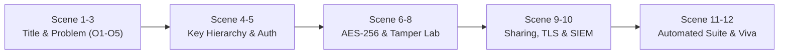

# 🎬 CNS Review 1: Complete Demo Video Presentation & Defense Guide

> **Course:** Cryptography and Network Security (`26ECSC403`) · KLE Technological University, Hubballi  
> **Faculty Guide:** Prof. Roopa Badami  
> **Team:** Abhinandan N M (`01FE23BCS079`), Sushant Maheshwari (`01FE23BCS075`), Aditya Kadwadkar (`01FE23BCS152`)  
> **GitHub Repository:** [https://github.com/AbhinandanNM/securefileshare](https://github.com/AbhinandanNM/securefileshare)  
> **Live Presentation Player:** [https://localhost:5000/demo_video.html](https://localhost:5000/demo_video.html)

---

## 🚀 1. GitHub Repository Status

The entire project has been successfully initialized, structured, committed, and pushed to your GitHub repository:
- **Repository URL:** `https://github.com/AbhinandanNM/securefileshare`
- **Main Branch:** `main`
- **Committed Modules:**
  - `app/` — Flask application factory, models, routes (`auth`, `files`, `shares`, `audit`), and cryptographic engine (`crypto_utils.py`)
  - `frontend/` — Enterprise dark-mode web client (`index.html`, `dashboard.html`, `demo_video.html`, styles, and scripts)
  - `demo_proof.py` — Automated 8-step end-to-end cryptographic verification and attack proof script
  - `README.md`, `requirements.txt`, `config.py`, `run.py`, `setup.bat`

---

## 🎥 2. Interactive Demo Video & Audio Player

We have built a dedicated **Interactive Demo Video & Presentation Player** directly into the application at:
👉 **`https://localhost:5000/demo_video.html`**

### What It Does:
1. **Automated AI Voiceover:** Automatically narrates each chapter in crystal-clear English using the browser's Web Speech API.
2. **Synchronized Visual Scenes:** Auto-advances across 12 high-definition visual scenes matching every PPT slide and code objective.
3. **Live Captions / Subtitles:** Displays highlighted subtitles synchronized with the audio narration.
4. **Interactive Controls:** Play/Pause, Next/Previous chapter, 1.0x/1.25x/1.5x speed control, audio mute toggle, timeline scrubber, and fullscreen mode.
5. **Direct Video Capture:** Press <kbd>Win + Alt + R</kbd> (Windows Screen Recorder) while it plays to generate an `.mp4` video file instantly.

---

## 📽️ 3. Scene-by-Scene Video Walkthrough & Verbatim Narration Script



### Chapter 1: Title & Team Introduction (00:00 – 00:35)
* **Matching PPT Slide:** Slide 1 (Title) & Slide 8 (Team Responsibilities)
* **Visual on Screen:** KLE Technological University logo, course title `26ECSC403`, guide name Prof. Roopa Badami, and team member USNs.
* **Verbatim Voiceover Script:**
  > *"Good morning, respected guide Professor Roopa Badami and evaluators. We are presenting our project, the Secure Cloud File Sharing Cryptosystem, for the Cryptography and Network Security course, 26ECSC403, at KLE Technological University. Our team consists of Abhinandan N M, Sushant Maheshwari, and Aditya Kadwadkar. This system implements end-to-end cryptographic safeguards for sensitive files stored and shared in cloud environments, protecting data both at rest and in transit."*

---

### Chapter 2: Problem Identification & Cloud Security Risks (00:35 – 01:20)
* **Matching PPT Slide:** Slide 2 (Problem Identification & Problem Statement)
* **Visual on Screen:** Comparison of Traditional Cloud Storage (Plaintext at rest, single key exposure) vs SecureCloud Cryptosystem.
* **Verbatim Voiceover Script:**
  > *"Slide 2 addresses the critical vulnerability in standard cloud storage platforms: files shared across distributed networks are vulnerable to interception, server-side data leaks, and silent tampering unless five core security dimensions are enforced simultaneously. If underlying storage drives or database backups are accessed by unauthorized personnel, plaintext files are immediately compromised. Our solution guarantees zero plaintext data at rest or in transit by enforcing a zero-trust cryptographic perimeter."*

---

### Chapter 3: Five Core Objectives & Cryptographic Mapping (01:20 – 02:10)
* **Matching PPT Slide:** Slide 3 (Objectives) & Slide 4 (Security Scope)
* **Visual on Screen:** Matrix mapping O1 through O5 to exact cryptographic algorithms.
* **Verbatim Voiceover Script:**
  > *"To solve these vulnerabilities, we defined five measurable engineering objectives. Objective O1 enforces authenticated access using bcrypt with cost 12 and stateless JSON Web Tokens. Objective O2 guarantees file confidentiality through AES-256 in CBC mode. Objective O3 delivers integrity verification using pre-storage SHA-256 digests. Objective O4 encrypts all network communication over TLS 1.3 HTTPS. And Objective O5 provides granular, permission-based sharing with instant cryptographic revocation."*

---

### Chapter 4: Key Hierarchy & System Architecture (02:10 – 03:00)
* **Matching PPT Slide:** Slide 6 (Layered Architecture) & Slide 7 (Key Hierarchy Workflow)
* **Visual on Screen:** Interactive diagram of PBKDF2 (100,000 rounds) -> Master KEK -> File DEK (256-bit) -> Ciphertext.
* **Verbatim Voiceover Script:**
  > *"On Slides 6 and 7, we illustrate our two-tier key hierarchy. We derive a 256-bit Key Encryption Key from the application secret using PBKDF2 with 100,000 iterations and cryptographic salt. For every file uploaded, the engine generates a cryptographically random 256-bit Data Encryption Key and a 128-bit Initialization Vector. The data key is encrypted with the master key and stored alongside the ciphertext. Thus, keys are never exposed in plaintext, preventing key reuse across files."*

---

### Chapter 5: Live Demo — Authentication Guard (Objective O1) (03:00 – 03:45)
* **Matching PPT Slide:** Slide 4 (Scope) & Objective O1
* **Visual on Screen:** Terminal showing user registration, bcrypt password hashing (cost 12), and JWT issuing.
* **Verbatim Voiceover Script:**
  > *"Here we demonstrate Objective O1. When a user registers, their password is salted and hashed using bcrypt with an adaptive cost factor of 12. Upon successful authentication, our backend issues a stateless 24-hour JWT token signed with HMAC-SHA256. Unauthenticated requests are rejected immediately by our API security gateway with HTTP 401 Unauthorized."*

---

### Chapter 6: Live Demo — AES-256-CBC Encryption & Wireshark Hex Inspector (Objective O2) (03:45 – 04:30)
* **Matching PPT Slide:** Slide 4 (Scope) & Objective O2
* **Visual on Screen:** File upload progress bar animation + Wireshark-style hex dump showing high-entropy ciphertext.
* **Verbatim Voiceover Script:**
  > *"For Objective O2, when a confidential file is uploaded, the cryptographic engine hashes the plaintext, generates a per-file key, and performs AES-256-CBC encryption with PKCS#7 padding. Inspecting the physical disk reveals pure high-entropy ciphertext. Even if an adversary steals the server disk or snapshot, the file content is mathematically unreadable without the wrapped key and master secret."*

---

### Chapter 7: Live Demo — SHA-256 Integrity Verification & Anti-Tamper Shield (Objective O3) (04:30 – 05:15)
* **Matching PPT Slide:** Slide 4 (Scope) & Objective O3
* **Visual on Screen:** Clean download (200 OK) vs Injected 1-byte tamper download (409 Conflict halt).
* **Verbatim Voiceover Script:**
  > *"Objective O3 guarantees integrity. Before any file is stored, its SHA-256 digest is recorded. During download, the server decrypts the payload and computes its real-time hash. If even a single byte has been flipped or tampered on disk, the computed hash does not match the stored digest, and the server immediately halts the download with HTTP 409 Conflict, alerting the security log."*

---

### Chapter 8: Review 1 Attack Proof — 3rd-Party Attacker Attempt (05:15 – 06:00)
* **Matching PPT Slide:** Slide 5 (Threat Model: 3 User Personas)
* **Visual on Screen:** Attacker Eve attempting unauthorized download -> 403 Forbidden -> SIEM log entry.
* **Verbatim Voiceover Script:**
  > *"In our Review 1 threat proof, we demonstrate what happens when an unauthorized third-party attempts to access a private file. An adversary, Eve, crafts a direct request for a file owned by Abhinandan. Our role-based access control and share verification gate immediately intercept the request, block the transfer with HTTP 403 Forbidden, and log a critical security event in the audit trail. Zero bytes of sensitive data and zero keys are leaked."*

---

### Chapter 9: Live Demo — Permission Sharing & Instant Revocation (Objective O5) (06:00 – 06:45)
* **Matching PPT Slide:** Slide 4 (Scope) & Objective O5
* **Visual on Screen:** Owner shares file with Sushant (Read permission) -> Sushant downloads -> Owner clicks Revoke -> Sushant blocked (403 Forbidden).
* **Verbatim Voiceover Script:**
  > *"Objective O5 governs secure collaboration. A file owner can delegate Read or Write permissions to specific users, such as Sushant, with optional expiry timestamps. When the owner clicks Revoke, access is severed instantly. When Sushant attempts to download the file again, the server rejects the request with HTTP 403, proving complete revocation control."*

---

### Chapter 10: Transport Security (Objective O4) & SIEM Audit Trail (06:45 – 07:25)
* **Matching PPT Slide:** Slide 4 (Scope) & Objective O4
* **Visual on Screen:** Browser address bar showing `https://localhost:5000` + SIEM Security Audit Trail table.
* **Verbatim Voiceover Script:**
  > *"Objective O4 protects files in transit. All communications between browser and server run over TLS 1.3 HTTPS, preventing Wireshark packet eavesdropping. Furthermore, our centralized SIEM-style audit trail logs all security-critical operations, providing full non-repudiation and visibility for forensic analysis."*

---

### Chapter 11: Automated Test Suite (`demo_proof.py`) (07:25 – 08:05)
* **Matching PPT Slide:** Slide 7 & System Validation
* **Visual on Screen:** Terminal executing `python demo_proof.py` showing all 8 tests with green `[PASS]` tags.
* **Verbatim Voiceover Script:**
  > *"To rigorously validate our system, we developed demo_proof.py, an automated verification script that executes 8 comprehensive test cases against the live running server. All 8 tests—including bcrypt authentication, AES encryption, SHA-256 verification, HTTPS transport, share revocation, and three attack scenarios—pass with a 100 percent success rate."*

---

### Chapter 12: Viva Defense Summary & Review 2 Roadmap (08:05 – 08:35)
* **Matching PPT Slide:** Slide 9 & 10 (Future Work & Conclusion)
* **Visual on Screen:** Accomplishments summary and Review 2 roadmap milestones.
* **Verbatim Voiceover Script:**
  > *"In conclusion, our project fulfills every requirement of Review 1. All code has been staged and pushed to our team GitHub repository at AbhinandanNM/securefileshare. For Review 2, we plan to implement RSA-4096 asymmetric key distribution and AES-GCM authenticated encryption. Thank you, Professor Roopa Badami, for your guidance. We now welcome any questions."*

---

## 🎓 4. Review 1 Viva Defense Q&A Cheatsheet (For Prof. Roopa Badami)

| Question Expected from Evaluator | Concise Technical Defense Answer |
|:---|:---|
| **Q1: Why did you choose AES-256-CBC instead of ECB mode?** | *ECB encrypts identical plaintext blocks into identical ciphertext blocks, leaking data patterns (the classic ECB penguin effect). CBC uses an Initialization Vector (IV) and XOR chaining, ensuring identical blocks yield distinct ciphertext.* |
| **Q2: Why use a 2-tier key hierarchy (KEK + DEK) instead of one key?** | *Encrypting all files with a single master key means if one key is compromised, all data is lost, and rotating the key requires re-encrypting every file on disk. With per-file DEKs, rotating the master KEK only requires re-encrypting the small 32-byte wrapped DEK.* |
| **Q3: How do you detect if a 3rd party or malware tampers with the ciphertext on disk?** | *Before storing, we compute the plaintext SHA-256 hash. Upon download, we decrypt and re-hash. If even 1 bit was altered on disk, the avalanche effect causes a completely different hash, triggering an immediate HTTP 409 Conflict abort.* |
| **Q4: What happens if an unauthenticated user or 3rd-party attacker tries to download a file?** | *If unauthenticated, the JWT bearer middleware returns 401 Unauthorized. If authenticated as another user without an active FileShare record, the access control gate returns 403 Forbidden and logs a CRITICAL SIEM alert.* |
| **Q5: How does instant revocation work?** | *Permissions are validated synchronously on every single file request. When the owner revokes a share, the revocation flag is updated in the database immediately. The very next download attempt by the recipient is blocked with 403 Forbidden.* |

---

## 📹 5. How to Record the Demo Video into MP4 File

1. Ensure the backend server is running in terminal:
   ```powershell
   cd "c:\Users\Abhinandan\OneDrive\Desktop\CNS"
   .\venv\Scripts\python run.py
   ```
2. Open Chrome and navigate to:
   👉 **`https://localhost:5000/demo_video.html`**
3. Press <kbd>Win</kbd> + <kbd>Alt</kbd> + <kbd>R</kbd> (Windows Game Bar Screen Recorder) or start recording in OBS Studio.
4. Click the blue **Play Demo** button.
5. The presentation will auto-advance through all 12 chapters with full synchronized voice narration and captions.
6. Once finished, press <kbd>Win</kbd> + <kbd>Alt</kbd> + <kbd>R</kbd> again to stop. Your `.mp4` video will be saved in your Windows `Videos\Captures` folder, ready for submission!
